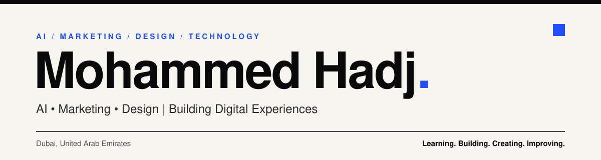
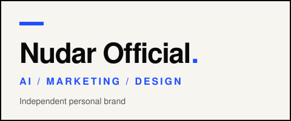
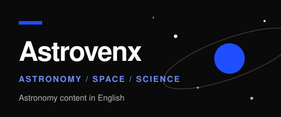

 

## About

I work across artificial intelligence, marketing, design, and technology, and I like building things where they overlap.

I write Python, work with SQL and MySQL, and make content and brand projects on the side. I am aiming at the sports, entertainment, and live events industries, in roles that mix creativity, technology, marketing, and data.

 

## Featured Projects

<table>
  <tr>
    <td width="50%" valign="top">
      
      
An independent personal brand sharing tools, ideas, resources, and educational content on AI, marketing, and design. Minimal editorial look: off-white, bold black type, blue accents.

      
<a href="https://www.instagram.com/nudarofficial">Instagram</a> · <a href="https://www.tiktok.com/@nudrofficial">TikTok</a>

    </td>
    <td width="50%" valign="top">
      
      
An independent astronomy content project covering discoveries, space exploration, celestial events, and educational topics. Published in English.

      
<a href="https://www.instagram.com/astrovenx">Instagram</a> · <a href="https://www.tiktok.com/@astrovenx1">TikTok</a> · <a href="https://www.youtube.com/@astrovenx">YouTube</a>

    </td>
  </tr>
</table>

 

## Skills & Tools

<table>
  <tr>
    <td width="33%" valign="top">
      <b>Programming & Technology</b>  
      
      
      
      
      
      
      
      
    </td>
    <td width="33%" valign="top">
      <b>Marketing & Design</b>  
      
      
      
      
      
      
      
      
    </td>
    <td width="33%" valign="top">
      <b>Productivity</b>  
      
      
      
      
    </td>
  </tr>
</table>

 

## Certifications

| Course | Issuer |
| :-- | :-- |
| Microsoft 365 Fundamentals Specialization | Microsoft / Coursera |
| Adobe Digital Marketing Course | Adobe |
| Responsible AI: Applying AI Principles | Google Cloud |

 

## Education

**Artificial Intelligence**, university studies in progress.

 

## Career Direction

I want to combine marketing, design, data analysis, and AI inside **sports, entertainment, live events, media, and technology**.

Fields I am working toward: Digital Marketing, Marketing Analytics, Design and Creative Technology, Data and Business Analytics, and AI Applications.

 

## Outside Work

Basketball, drawing, astronomy, technology, and digital creativity.

 

## GitHub Stats

  

 

## Collaboration

I am open to collaborating on AI, marketing, design, branding, content, and technology projects. I am also open to relevant internships and employment opportunities.

Reach me at [mhmdbsclb@gmail.com](mailto:mhmdbsclb@gmail.com) or through [Instagram](https://www.instagram.com/nudarofficial).

 

**Learning. Building. Creating. Improving.**

