## The city I built this year

Every building is a day. Taller means more contributions.

## Population

## Landmarks

<a href="https://github.com/nudarofficial/bug-hunter">bug-hunter</a> ·
<a href="https://www.instagram.com/nudarofficial">Nudar Official</a> ·
<a href="https://www.youtube.com/@astrovenx">Astrovenx</a> ·
<a href="https://github.com/nudarofficial?tab=repositories">All repositories</a>

## Visit

<a href="https://www.instagram.com/nudarofficial">Instagram</a> ·
<a href="https://www.tiktok.com/@nudrofficial">TikTok</a> ·
<a href="https://www.youtube.com/@astrovenx">YouTube</a> ·
<a href="mailto:mhmdbsclb@gmail.com">Email</a>

<b>Learning. Building. Creating. Improving.</b> · Cards rebuilt daily with GitHub Actions

